# Truckroll

A CRM for heating, cooling and plumbing companies, with AI where the day actually goes:
finding what's installed at a house, picking the right technician for a job, and turning a
phone call into a booked job and a follow-up.

It's built on ASP.NET Core 10, EF Core, MySQL, Redis, SignalR and Next.js. Everything runs on one
machine and costs nothing: a local model through Ollama, with Claude one setting away.

<picture>
  <source media="(prefers-color-scheme: dark)" srcset="docs/screenshots/dark/landing.png">
  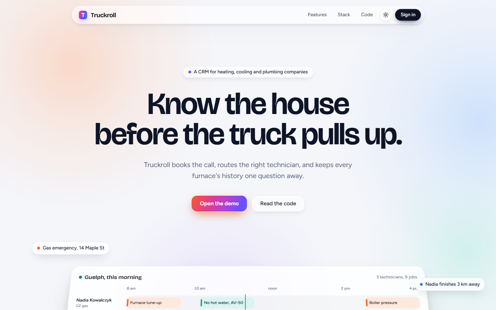
</picture>

## Demo


A dispatcher signs in and drags an emergency onto a technician's lane. Then they open the job
to see who the rules would send and why, and ask the assistant what's installed at the house.
The full-size video is [truckroll-demo.mp4](docs/demo/truckroll-demo.mp4), and
[docs/DEMO.md](docs/DEMO.md) is the two-minute live script.

## What's in it

|                                                                                                                                                                                                                                                        |                                                                                     |
| ------------------------------------------------------------------------------------------------------------------------------------------------------------------------------------------------------------------------------------------------------ | ----------------------------------------------------------------------------------- |
| **A live dispatch board.** A map of trucks and jobs, and a lane per technician. Drag a job onto a lane and every open board moves with it, over SignalR. A lane whose technician lacks the licence refuses the drop and says why.                     | 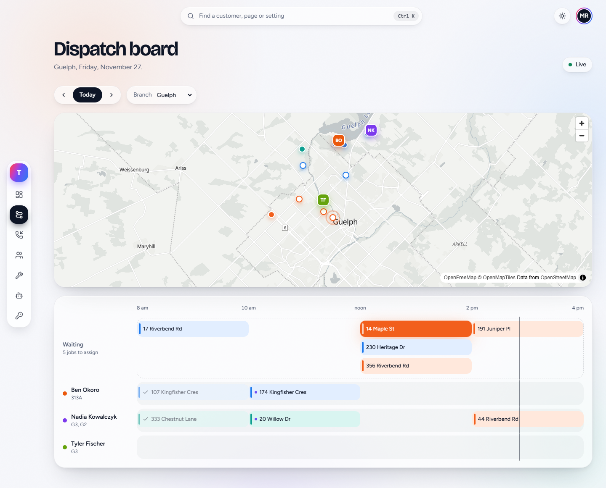                          |
| **Who should go.** For any job, the top three technicians, ranked in plain C# by licence, skill, timing, distance and workload. The model writes one sentence on each and can't change the order. The dispatcher picks.                                  | 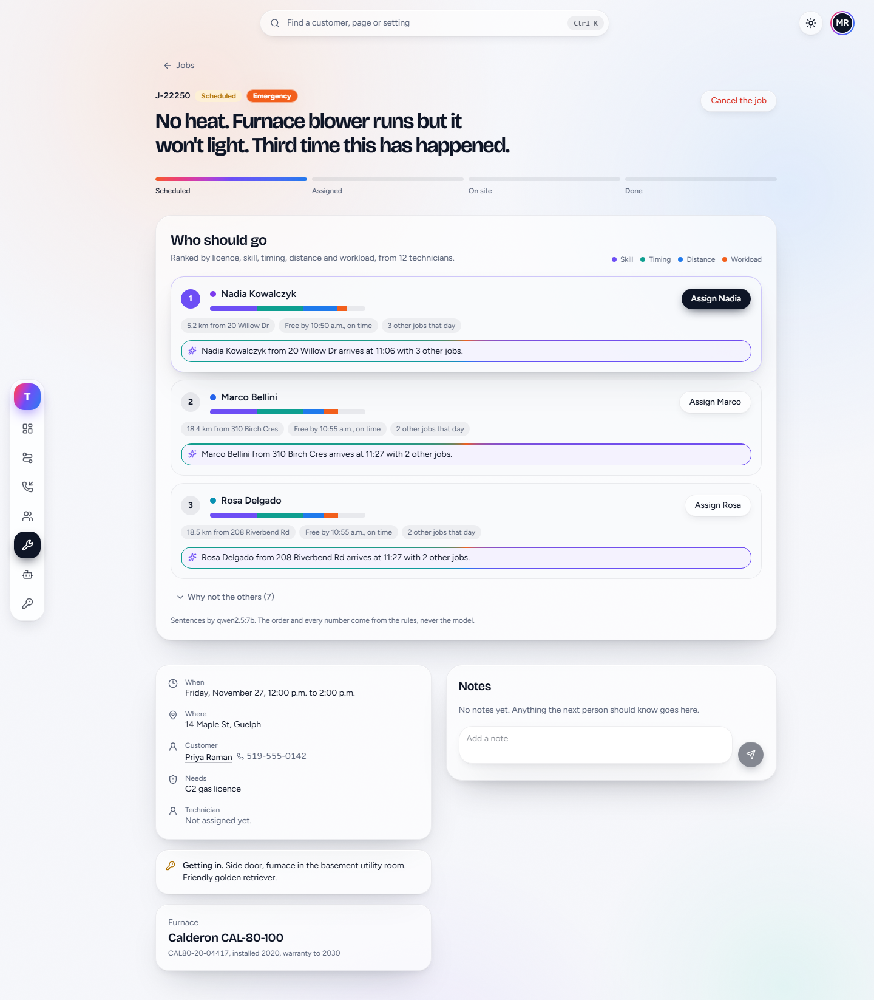        |
| **Ask Truckroll.** Questions about equipment, manuals, warranties, policies and job history, answered from your own data with numbered citations. Sources show first, then the answer streams. Each citation opens its passage.                      | 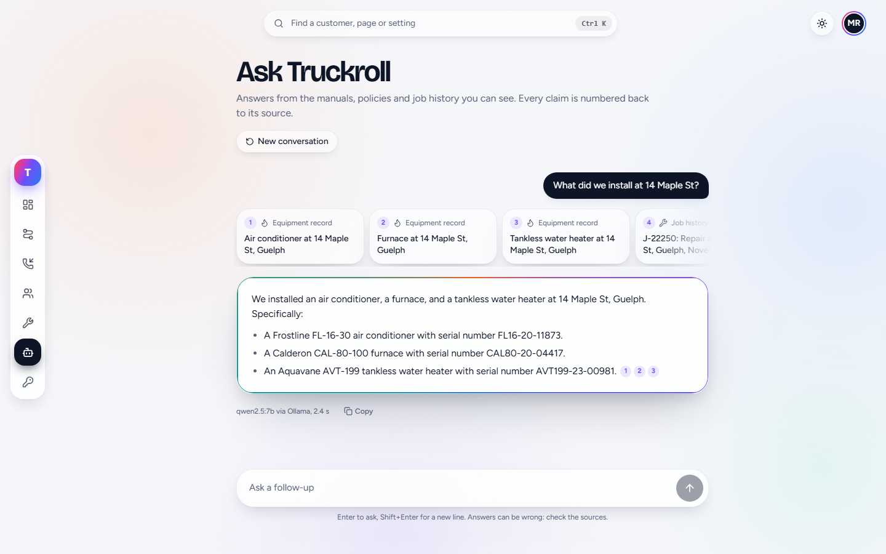     |
| **Calls to jobs.** A call transcript becomes a matched customer, a proposed job and a drafted follow-up. Code matches the customer, computes the date and enforces safety rules. A person approves, and the follow-up goes to an outbox: Truckroll never sends email. | 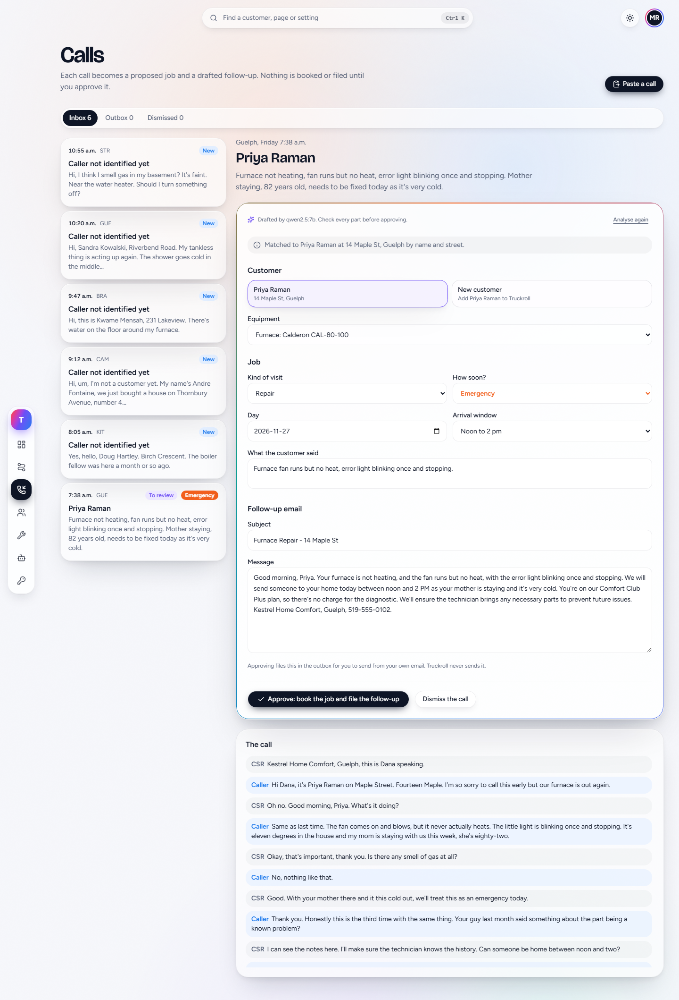                  |
| **Customer 360.** The home, its equipment with serials and warranties, the membership plan and every visit, in one place.                                                                                                                            | 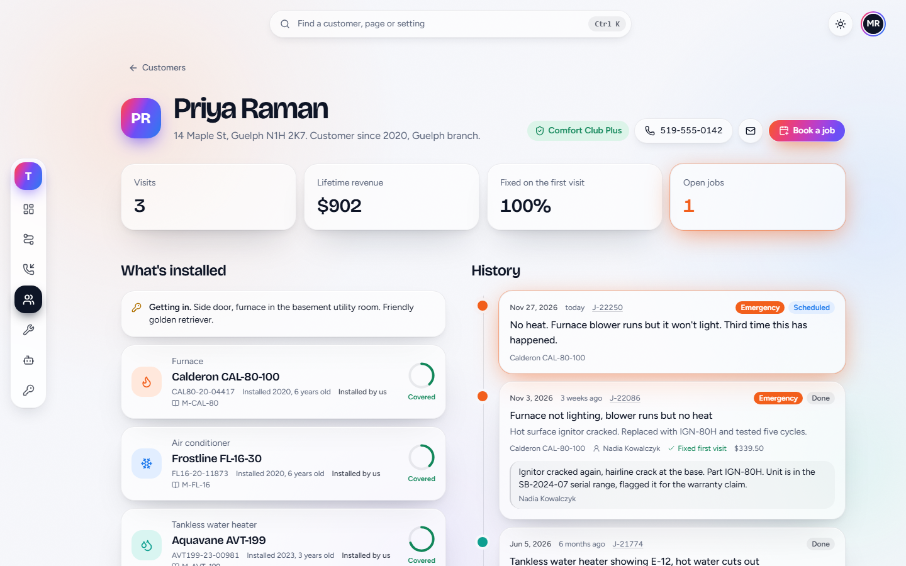                       |
| **The owner's numbers.** Jobs, first-time fix, revenue, hours to dispatch and memberships for each branch, against the previous period.                                                                                                              | 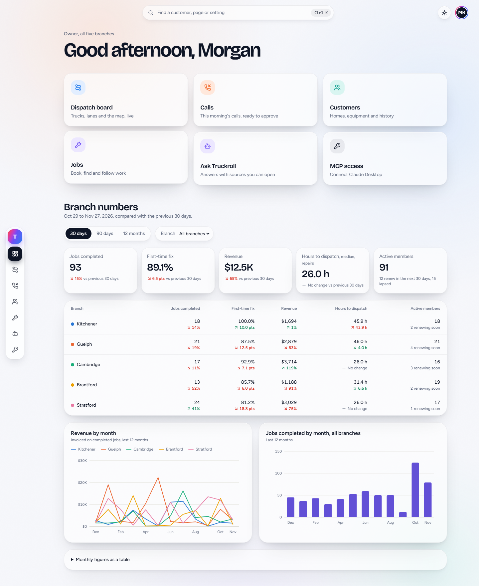                        |
| **MCP access.** Each person creates their own token and pastes a generated config into Claude Desktop. Seven tools, all running as that person.                                                                                                       | 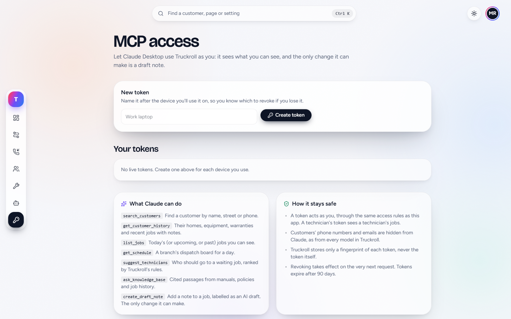                       |

There's also a jobs list with booking, sign-in by role, a ⌘K command palette, and light and dark
themes. Every screenshot is also in [dark](docs/screenshots/dark/).

## Architecture

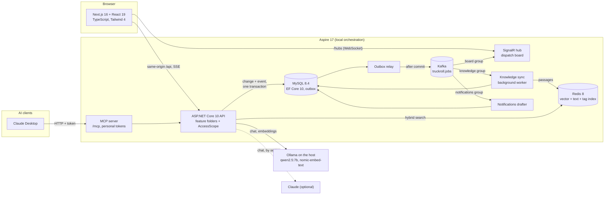

One rule holds the design together: **there is one place that decides who can see what.**
`AccessScope` scopes every read by role and branch: the web pages, the assistant's retrieval,
dispatch suggestions and every MCP tool. A convention test fails the build if feature code
reads a table without it. So a technician's assistant can't cite another branch's customer,
and a token can't see more than its owner.

### How a question gets answered

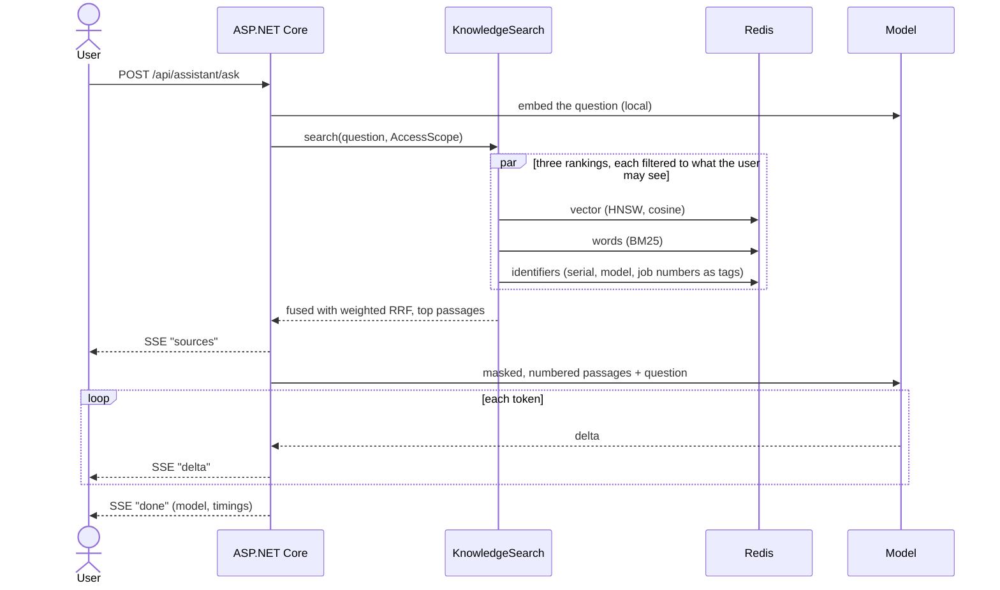

A background worker keeps Redis in step with MySQL. It indexes every manual section, piece of
equipment and job on startup, and re-indexes a job seconds after it changes. Phone numbers and
emails are masked before anything is embedded.

### How a dispatch suggestion is made

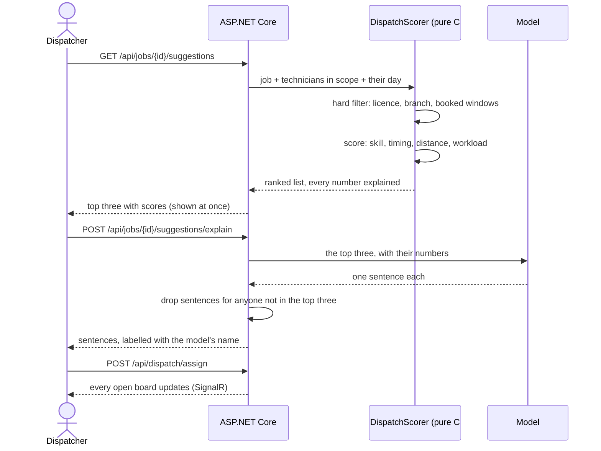

The ranking shows instantly, and the sentences fill in when the model is done. If the model is
slow or down, the dispatcher still has the ranking and the numbers behind it.
[ADR-007](docs/adr/007-code-ranks-the-model-explains.md) has the reasoning.

## Built for the job

This repo targets the stack a growing, multi-location home-services company runs on, and the
places that company wants AI. Here's where each part lives, and what's still planned.

| The job asks for                       | Where it is in this repo                                                                                                         |
| -------------------------------------- | -------------------------------------------------------------------------------------------------------------------------------- |
| C# / .NET                              | .NET 10 LTS, minimal APIs in feature folders, nullable and warnings-as-errors ([ADR-001](docs/adr/001-dotnet-10-lts.md))        |
| ASP.NET Core                           | `src/Truckroll.Api`: cookie auth with Identity, a custom bearer scheme for MCP, SSE streaming, a background worker                |
| EF Core + MySQL                        | EF Core 10 on MySQL 8.4 through the Microting provider, with migrations and a deterministic seed ([ADR-002](docs/adr/002-mysql-provider-for-ef-core-10.md)) |
| Redis                                  | Redis 8's Query Engine as the search index: vectors, BM25 text and tags in one index ([ADR-003](docs/adr/003-retrieval-in-redis.md)) |
| SignalR                                | The dispatch board: every open board moves when a job is assigned (`Features/Dispatch/DispatchHub.cs`)                           |
| TypeScript, React, Next.js             | `web/`: Next.js 16, React 19, TanStack Query, Motion, MapLibre, same-origin API ([ADR-006](docs/adr/006-same-origin-api.md))     |
| AI in customer service                 | Calls to jobs: structured output, code-side matching and safety rules, approval before anything is booked                        |
| AI in scheduling and dispatch          | Dispatch suggestions: code ranks, the model explains ([ADR-007](docs/adr/007-code-ranks-the-model-explains.md))                  |
| AI across the business                 | The cited assistant, and an MCP server so Claude Desktop can work in the CRM as its user ([docs/MCP.md](docs/MCP.md))           |
| Docker                                 | Aspire runs MySQL, Redis and Kafka in containers; tests use Testcontainers, Kafka included ([ADR-008](docs/adr/008-aspire-for-local-orchestration.md))  |
| Kafka                                  | Every job change and its event commit together through a transactional outbox, and a relay sends them to Kafka. The board, the search index and a notifications drafter each read as a consumer group of their own ([ADR-005](docs/adr/005-modular-monolith-then-kafka.md), [ADR-009](docs/adr/009-one-topic-at-least-once.md)) |
| Observability, Datadog                 | OpenTelemetry traces, metrics and logs: model calls carry the provider, model and token counts, and job events are counted by type. The Aspire dashboard shows them locally. Set a Datadog API key and the Datadog Agent gets a copy over OTLP, for a dashboard committed as JSON ([ADR-010](docs/adr/010-opentelemetry-to-datadog-agent.md), [docs/OBSERVABILITY.md](docs/OBSERVABILITY.md)) |
| React Native                           | The technician app, offline first, is **v0.3** ([ROADMAP.md](ROADMAP.md))                                                        |
| Kubernetes, GitHub Actions             | A workflow is committed and runs the same gate script. Kubernetes with Argo CD is **v0.4**                                       |

## Measured

The model's answers are only as good as what reaches it, so each AI feature has an eval with a
bar it has to clear. `tools/Truckroll.Eval` runs them and writes the results pages; the
numbers below are copied from those pages.

### Retrieval

61 questions with known answers (7 of them by serial, model or job number) against the seeded
knowledge base. Full table: [evals/results.md](evals/results.md).

| Search     | hit@1 | hit@5 |  MRR |
| ---------- | ----: | ----: | ---: |
| hybrid     |  0.84 |  1.00 | 0.91 |
| vector     |  0.80 |  0.92 | 0.86 |
| keyword    |  0.74 |  0.95 | 0.83 |

Hybrid finds the right passage in the top five for every question, and ranks it first more
often than vectors alone. That second part is the bar Showroom AI, the project before this one,
missed: there, exact codes were found by keyword search and then out-voted. Here identifiers
get a ranking of their own, and on the identifier questions alone it scores hit@1 0.86.

### Dispatch ranking

20 scenarios, each with the technician an experienced dispatcher would send. They were written
before the scorer was run on them. Full table: [evals/dispatch-results.md](evals/dispatch-results.md).

| Expected technician | Result | Bar   |
| ------------------- | -----: | ----: |
| in the top three    |   100% | ≥ 90% |
| ranked first        |    95% |       |

### Call extraction

10 labelled calls through the real model, scoring 7 fields each: type, priority, equipment,
customer, day, hour and safety. Full table:
[evals/extraction-results.md](evals/extraction-results.md).

| Fields right | Result | Bar   |
| ------------ | -----: | ----: |
| 66 of 70     |    94% | ≥ 90% |

Priority, customer, day and the safety flag were right on every call. The four misses were two
visit types (a tankless water heater acting up read as maintenance, a gas smell as an
estimate), and the equipment and hour for a new caller asking about an AC quote. Every field
is in front of a CSR, editable, before anything is booked. The gas call still came out as an
Emergency, which code enforces for any gas smell whatever the model says.

## Running it locally

You need the [.NET 10 SDK](https://dotnet.microsoft.com/download/dotnet/10.0), Docker, Node 22+
and [Ollama](https://ollama.com). [docs/ONBOARDING.md](docs/ONBOARDING.md) has the longer
version, with the problems I actually hit and how to fix them.

```bash
ollama pull qwen2.5:7b
ollama pull nomic-embed-text
cd web && npm install && cd ..
dotnet run --project src/Truckroll.AppHost --launch-profile http
```

The console prints a link to the Aspire dashboard, which shows every resource with its logs and
traces. The web app is at http://localhost:3000. Pick a role card on the sign-in page; the
password for every demo account is `truckroll-demo`.

| Login                 | Role           | Sees                                 |
| --------------------- | -------------- | ------------------------------------ |
| `morgan@kestrel.test` | Owner          | All five branches, and the dashboard |
| `pat@kestrel.test`    | Branch manager | Kitchener                            |
| `alex@kestrel.test`   | Dispatcher     | Guelph's board, jobs and calls       |
| `dana@kestrel.test`   | CSR            | Guelph's customers and calls         |
| `nadia@kestrel.test`  | Technician     | Her own jobs and those customers     |

On first start the API seeds Kestrel Home Comfort for today, and builds the search index in
about 40 seconds. The `api` resource in the dashboard has **Reset demo data** and **Rebuild
knowledge index** buttons. The demo is seeded for the day it was created, so reset it on
another day.

**Claude instead of Ollama.** Change one setting and add a key. Embeddings stay local either way
([ADR-004](docs/adr/004-models-behind-microsoft-extensions-ai.md)).

```bash
dotnet user-secrets --project src/Truckroll.Api set "AI:Provider" Claude
dotnet user-secrets --project src/Truckroll.Api set "AI:Claude:ApiKey" <your key>
```

**The evals.** With the stack up, run `dotnet run --project tools/Truckroll.Eval -- --write`
for retrieval, `--suite dispatch` (offline) or `--suite extraction` (real model). Each one
rewrites its page in `evals/`.

**Claude Desktop.** Create a token on the **MCP access** page and paste the config it gives you.
[docs/MCP.md](docs/MCP.md) covers the seven tools and the security model.

## Quality gate

```powershell
./scripts/ci.ps1     # or ./scripts/ci.sh
```

`dotnet format`, a Release build with warnings as errors, 243 xUnit tests against real MySQL and
Redis in Testcontainers, ESLint, `tsc` and a production `next build`. Tests never call a real
model: a scripted fake chat client and a hashing embedder stand in. GitHub Actions is locked on
this account, so the gate runs locally before every merge; the workflow in `.github/workflows`
runs the same script once it's unlocked.

With the stack running, `./scripts/ci.ps1 -EndToEnd` (or `./scripts/ci.sh --e2e`) adds the
Playwright tests: each role signs in, a dispatcher drags a job between lanes while a second board
follows live, the assistant answers with citations, and a call becomes a booked job. They use the
real model, so they check the shape of an answer, not its wording. `npm run capture` in `web/`
regenerates the screenshots and the demo video.

## Docs

| Doc                                   | What it's for                                                       |
| ------------------------------------- | ------------------------------------------------------------------- |
| [DESIGN.md](docs/DESIGN.md)           | The plan: scope, domain model, AI design, and what changed building it |
| [docs/adr/](docs/adr/)                | Architecture decisions, one per file, with the trade-offs           |
| [MCP.md](docs/MCP.md)                 | Connecting Claude Desktop, the tools, and the security model        |
| [OBSERVABILITY.md](docs/OBSERVABILITY.md) | What's measured, turning Datadog on, and importing the dashboard |
| [AI_WORKFLOW.md](AI_WORKFLOW.md)      | How a team should use AI, both coding with it and shipping it       |
| [ONBOARDING.md](docs/ONBOARDING.md)   | First day: setup, troubleshooting, a reading order and a first ticket |
| [CONTRIBUTING.md](CONTRIBUTING.md)    | Branches, commits, PRs and the quality gate                         |
| [CODE_REVIEW.md](docs/CODE_REVIEW.md) | What I look for in review                                           |
| [ROADMAP.md](ROADMAP.md)              | Kafka, the technician app and hosting, planned as a quarter         |
| [DEMO.md](docs/DEMO.md)               | A two-minute demo script                                            |

## Known limits

- **A 7B model is a 7B model.** It reads a passage and cites it well, and gets dates and
  ranking wrong. That's why code does the dates, the matching and the ranking, and the model
  does the words. On a recent GPU an answer takes seconds; on a CPU, expect much longer.
- **No rate limits yet.** The assistant and MCP aren't throttled, because v0.1 runs on one
  person's machine. They come with hosting in v0.4.
- **One relay per deployment.** The outbox relay assumes a single API instance; a second would
  send the same events again (consumers would ignore them, but it's waste). A lease comes with
  hosting in v0.4 ([ADR-009](docs/adr/009-one-topic-at-least-once.md)).
- **Straight-line distance.** Dispatch scores distance as the crow flies, not by road.
- **Demo data only.** Kestrel Home Comfort, its people, customers and equipment brands are
  made up. Nothing is ever sent to a customer.

## Stack

.NET 10 · ASP.NET Core · EF Core 10 · MySQL 8.4 · Redis 8 (NRedisStack) · Kafka (Confluent.Kafka) · SignalR · Aspire 17 ·
Microsoft.Extensions.AI · Ollama · Anthropic · ModelContextProtocol · Next.js 16 · React 19 ·
TypeScript · Tailwind 4 · Motion · MapLibre · TanStack Query · xUnit v3 · Testcontainers ·
Playwright

## License

Copyright (c) 2026 Amr Abdallah. All rights reserved.

The source is public to read, not to use. You may view it to evaluate my work, but you may not run, copy, modify, redistribute or train AI models on it. See [LICENSE](LICENSE) for the full terms.
